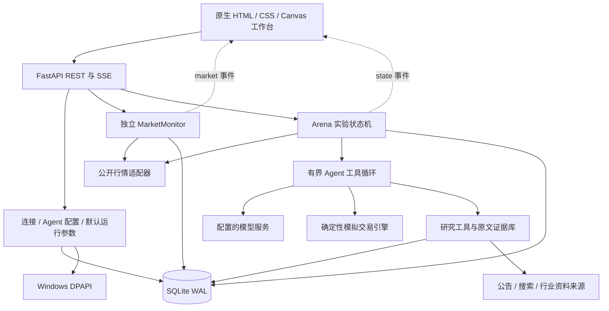
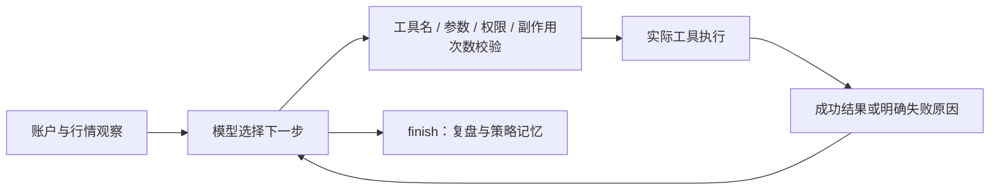

# Alpha Lab 项目设计说明

整理日期：2026-10-14。本文描述交付包中的实际实现，规划项单独标注。项目面向 Python 后端校招展示与 Agent 实验，不连接真实证券账户。

## 1. 要解决的问题

让用户可以配置多个带独立记忆与工具权限的 LLM Agent，在同一模拟交易环境里研究股票、提交交易意图、观察实际执行结果，再修订策略。系统提供历史回测、冻结策略的后续区间验证、经验迁移和实时模拟。

首页是独立行情工作台。当前打开历史实验时，也可以查看最新报价；首页的实时数据不会进入历史实验的账户或模型观察。默认每位 Agent 初始虚拟资金为 100 万元，默认名称为 deepseek-1 至 deepseek-6。相同模型的不同策略是策略对照，不冒充不同模型。

项目的后端核心是：不确定的模型提出意图，确定性的执行器负责校验与记账；所有展示的交易结果来自执行器。模型声称成功不等于实际成交。

## 2. 系统边界与架构

部署边界是单机、单用户、单个 Uvicorn worker。asyncio 锁、信号量和内存缓存都属于该进程。SQLite 不是分布式数据库，当前代码不能直接改成多个 worker 并宣称完成扩容。

## 3. 模块与源码入口

| 模块 | 责任 | 推荐关注的入口 |
| --- | --- | --- |
| `app/main.py` | 请求校验、接口、同源限制、SSE、应用生命周期 | `lifespan`、`stream`、创建与推进接口 |
| `app/engine.py` | 实验创建、轮次执行、学习与验证、迁移、恢复 | `new`、`step`、`commit`、`capture_checkpoint`、`promote` |
| `app/agent.py` | 模型 HTTP 调用、上下文压缩、并发与预算、工具循环 | `completion`、`run` |
| `app/broker.py` | 金额、资金冻结、订单状态、持仓批次与撮合 | `submit`、`cancel`、`match_orders` |
| `app/market.py` | 股票代码规范化后的行情、日线、搜索与市场扫描适配 | `quotes`、`bars`、`historical_quotes` |
| `app/market_monitor.py` | 与实验独立的实时行情、缓存、自选、采样与后台刷新 | `refresh`、`detail`、`public`、`start` |
| `app/configuration.py` | 可复用 Agent 模板、模型连接、参数校验 | `normalize_profile`、`save_profile`、`save_connection` |
| `app/secrets.py` | 当前 Windows 用户的密钥加解密 | `seal`、`unseal` |
| `app/research.py` | 搜索、允许来源、HTML/PDF 提取与访问限制 | `allowed_url`、来源注册和读取函数 |
| `app/evidence.py` | 原文分块、哈希、发布时间与连续引文验证 | `EvidenceStore` |
| `app/research_tools.py` | 公告、行业报告、财务摘要、证据查询与研究笔记 | 工具执行入口 |
| `static/app.js` | 实验页面、事件订阅、账户详情与历史曲线 | `renderView`、`renderDashboard` |
| `static/live-workspace.js` | 首页行情、股票选择、自选管理、价格图表 | `accept`、`loadDetail`、`drawChart` |
| `static/admin.js` | 模型连接、Agent、资料与运行参数页面 | 表单提交与配置刷新 |

## 4. 三类时钟与两条数据路径

必须区分模拟日期、系统北京时间、行情源报价时间。一次成功 HTTP 请求的时间不能替代原始报价时间。

### 历史实验路径

1. 用户选定起止交易日与可选验证起点。
2. 第一轮使用所选日期收盘时可见的日线；后续轮次先推进交易日。
3. 撮合此前已提交的委托，再计算账户反馈。
4. 冻结所有选手的共同初始行情观察，启动各自的研究与工具循环。
5. 新委托只会在后续轮次按模拟规则尝试成交，不能回到已知的当日收盘价立即成交。
6. 完成选定区间后停止，不能偷偷使用区间外数据补成交。

按需发现新股票后，历史日线也必须按模拟日期截断。现时网页、公司档案和当前财务摘要在历史模式被禁止；归档资料必须满足发布日期与历史可用性检查。

这仍不能消除模型预训练知识、现存证券目录、缺失公司行为等偏差，不能宣称无偏金融回测。

### 首页实时路径

`MarketMonitor` 独立读取公开报价，默认 30 秒刷新。它拥有自己的报价字典、采样、日线缓存和自选配置，不会调用 `Arena.mark` 或替换历史 `state.quotes`。

用户打开已完成回测时，首页仍显示最新股票详情。回测的 15/15 是历史任务完成状态，继续保留在历史页；首页用最新报价时间和检查时间说明刷新情况。

实时模拟账户的估值与已有委托撮合仍走 `Arena.refresh`。Agent 决策由时间或波动条件触发，并由用户开启，不与每次首页行情检查绑定。

## 5. Agent 循环与主动性

每轮输入包括独立账户、共同初始行情、近期表现、自己的笔记、策略版本、当前阶段与执行规则。模型通过兼容 Chat Completions 的工具调用协议选择后续动作。

模型可选择搜索标的、读取日线、查询公告、阅读原文、提交或撤销委托、保留现金、保存假设及结束本轮。程序定义边界，不预先写死每只股票的买卖路径。

默认每轮最多 7 次模型决策，可配置为 2–12 次；一次响应最多处理 4 个工具；每轮最多 4 次订单修改。最后一次决策只允许 `finish`。工具权限既影响发送给模型的列表，也在执行器再次检查。

执行记录显示公开说明、工具输入与实际返回，不把模型内部思维链当作审计证据。模型和工具业务错误通常转换为反馈，让本轮继续或结束；未捕获异常与任务取消才触发轮次级回滚。这两层处理不能混为一谈。

## 6. 并发、预算与一致性

多个选手使用 asyncio 任务并发等待外部服务。模型请求通过全局信号量限制同时在途数量，另有调用预算与超时。HTTP 连接和研究来源也有独立资源边界。

每轮在正式状态的深拷贝上执行，选手只修改自己的工作账户。资产发现的共享数据注册由锁保护。全轮正常完成后，账户状态、快照、命令幂等记录在同一个 SQLite 事务中提交。

`request_id` 唯一键与实验锁防止已提交轮次被重复推进。它保护的是本地状态，不保证模型供应商计费 exactly-once。提交前宕机后重试，外部调用可能再次发生。

工具轨迹独立实时落库；最终关联提交、回滚或中断状态。失败轮的账户副本不会替换已提交账户。重启恢复最后持久化的实验状态，自动决策默认关闭；当前没有自动恢复运行中的分布式任务。

预算主要是进程级控制，服务重启会重置部分计数。选手累计调用与 Token 随实验保存。当前未实现跨进程持久化额度预占、供应商账单对账或全局速率调度。

## 7. 确定性模拟账本

内部金额使用整数分，模型观察与工具参数使用人民币元。所有跨边界现金、净值、委托价格和费用需要明确转换。

买入委托冻结限价金额及预计费用，现金总额与可用现金区分；撮合后按实际模拟价格扣款，撤单或过期释放冻结。卖出按持仓批次判断可卖数量。执行器再检查数量、报价时效、限价、可用资金、仓位和支持的申报规则。

订单通过 pending、filled、cancelled、expired、rejected 等状态表达结果。状态转换、资金和持仓必须一致，不能只靠模型输出或前端动画判断交易成功。

当前没有真实盘口队列、部分成交、市场冲击、完整公司行为和券商结算。这里的规则是模拟实现；完整参数与制度覆盖范围见 README，不应把模拟收益写成真实投资成绩。

## 8. 策略迭代、验证与迁移

学习阶段通过 `lesson` 与 `next_strategy` 更新显式策略记忆，并在下一轮上下文中使用。这个过程不更新模型权重，不属于本项目实现的强化学习训练。

验证开始前捕获策略检查点。验证期拒绝持久研究笔记写入，复盘可以记录公开说明，但不能修改部署用策略与版本。后端强制这些规则，不能只用提示词请求模型自觉遵守。

迁移时创建新实时实验，仅继承经验、允许的研究笔记和历史来源，账户重新获得初始虚拟资金。历史持仓、待成交委托和收益曲线不继承。来源包保留训练截止、验证区间、策略版本及当时的评估结果。

“已有验证样本”是证据可用性门槛，不代表稳定盈利。没有真正策略版本的选手不能假装已完成学习并迁移。

## 9. 外部研究与证据

外部资料经工具读取，保存来源 URL、发布时间、取得时间、原文哈希和正文分块。研究结论可以关联文档与分块，并校验引用是否是连续原文；伪造引文被拒绝。

网页正文属于不可信资料。模型没有任意 shell、文件系统或任意 HTTP 能力；读取来源受来源 ID、域名、HTTPS、重定向、地址和大小限制。PDF 提取有下载与页数上限，扫描版缺少可提取文字时明确失败，不生成假原文。

允许域名和引文存在只能证明访问范围或原文出处，不能证明资料真实、分析正确或完全抵御 prompt injection。当前没有向量数据库；现有证据查询不应在简历上写成已完成向量 RAG 系统。

## 10. 实时行情缓存与 SSE

- 报价刷新使用锁与 TTL，多个页面并发请求共享一次供应商读取，减少缓存击穿。
- 日线缓存 5 分钟，股票详情不会每次切换都重复下载全部历史。
- 实时采样只在行情源时间或价格变化时增加，最多保留 240 点；检查时间推进不会制造价格波动。
- 行情失败保留最近报价并标记错误与未更新股票，报价时间不改成当前时间。
- 休市、午休与待有效报价状态显式显示，不能仅用 HTTP 成功判断可交易。
- `market` 与 `state` 是不同 SSE 事件。前者更新行情，后者同步实验。
- 行情响应带 `monitor_id` 和 `revision`。同一实例的旧响应不覆盖新值，服务重启后的新实例可以重新同步。
- SSE 是最新状态重同步，没有实现逐事件 exactly-once 或完整事件回放；断线重连不等于审计事件可靠投递。

## 11. 数据表与恢复

| 表 | 保存内容 |
| --- | --- |
| `matches` | 实验元信息和当前 JSON 状态 |
| `snapshots` | 实验各已提交 revision 的 JSON 快照 |
| `commands` | 已提交命令的 request_id 与实验关联 |
| `traces` | 工具执行轨迹、输入、返回、轮次与提交状态 |
| `settings` | 当前实验、全局默认参数、自选列表等 |
| `connections` | 可公开连接信息与加密凭据分列保存 |
| `agent_profiles` | 可复用 Agent 配置 |
| 证据相关表 | 原文、分块、出处和历史可用性元信息，定义见 `EvidenceStore` |

JSON 快照便于原型恢复，但大规模筛选、聚合与索引能力有限。SQLite 调用与 PDF 解析也不是自动非阻塞，这是后续性能分析应实际测量的部分。

## 12. 技术选型与替代方案

| 当前选择 | 当前理由 | 何时考虑替代 |
| --- | --- | --- |
| FastAPI + asyncio + httpx | 外部模型与资料请求以 I/O 等待为主，接口与异步流程直接可读 | CPU 密集工具使用进程或隔离 worker |
| SQLite WAL | 单用户本地体验、事务和快照部署简单 | 多用户或多 worker 时评估 PostgreSQL 和结构化表 |
| 进程内任务与锁 | 首版保持执行路径清晰 | 长任务跨进程恢复需要持久化任务调度与占用机制 |
| SSE | 浏览器以接收状态为主，支持标准重连 | 高频双向交互再评估 WebSocket；可靠事件回放需单独日志机制 |
| 原生 JS / Canvas | 无前端构建即可运行，图表直接由实际数据绘制 | 页面规模增加时评估组件框架与图表库 |
| 直接工具调用循环 | 权限、预算、执行结果和失败边界可逐步审查 | 复杂图编排且有明确收益时再引入编排框架 |
| 原文分块与引用校验 | 先实现真实来源和时间边界 | 有评估数据支撑时再引入向量检索与排序 |
| Windows DPAPI | 本机凭据加密与当前用户绑定，不明文落库 | Linux/云端需真正的密钥管理适配，不能搬运本机密文 |

Redis、消息队列、微服务、向量数据库不是当前已实现能力。引入它们需要明确解决故障恢复、共享缓存、任务扩容或检索效果问题。

## 13. 已验证与尚未验证

已完成的工程验收包括 91 项后端测试；隔离浏览器行情 11 项、历史工作流 10 项、配置 7 项流程；展示服务 52 项只读界面检查。对应测试使用明确的模拟环境，不能作为真实 Agent 收益评估。

真实行情服务曾验证 30 秒自动检查与 SSE 更新，原六位 Agent 的 15 轮历史实验保留。交付包不带该本机数据库或密钥，解压后的实例从新数据目录开始。

尚未完成：多实例并发一致性、持久化后台任务自动恢复、量化压测、长期 Agent 效果对照、无偏历史资料库、完整金融市场模拟和公开云端部署。

## 14. 面向简历的下一阶段

建议先建立持久化任务状态与恢复边界，再测量接口并发、SSE 连接、任务失败与恢复时间；最后建立固定数据集下的 Agent 对照实验，比较工具成功率、引用准确率、耗时与成本。

所有指标应来自可复现脚本和明确实验条件。不要把计划中的 PostgreSQL、Redis、队列、强化学习、压测数字或稳定盈利写成已实现成绩。

## 15. 设计参考

- TradingAgents 官方项目：<https://github.com/TauricResearch/TradingAgents>，用于理解多角色研究与交易协作思路；本项目没有直接集成该框架。
- Anthropic Agent 评估：<https://www.anthropic.com/engineering/demystifying-evals-for-ai-agents>，用于理解执行过程与最终结果的分别评估。
- TradeRank：<https://www.traderank.ai/>，公开模型竞赛与决策展示。
- AlphArena：<https://alpharena.io/>，绩效与交易理由关联的展示思路。
- Hyper Alpha Arena：<https://github.com/HammerGPT/Hyper-Alpha-Arena>，多账户交易工作台参考；本项目没有直接依赖其源码。

参考不等于独创声明、源码依赖或对当前线上能力的背书。实际功能以此源码、测试和限制说明为准。
