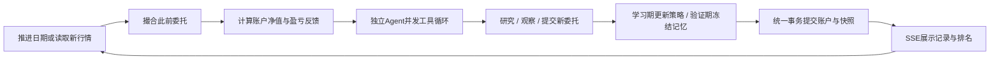

# 用这个项目说明你的后端与 Agent 能力

交付版更新：2026-10-14。结合 `DESIGN.md` 与 `DELIVERY_GUIDE.md` 阅读。下面的回答以当前源码为边界，扩展方案不等于已实现。

## 一句话介绍

“我做了一个 A 股虚拟交易 Agent 实验工作台。可以配置 1–8 位选手，让它们在历史区间通过交易反馈修订策略，在后续区间冻结策略验证，然后把带来源的经验迁移到实时行情。每位独立管理 100 万元，研究和交易过程可以审计。”

演示顺序：先看实时首页的报价时间与股票详情 → 打开历史实验查看学习和验证表现 → 展示一位选手的策略版本和冻结检查点 → 选中已有复盘的选手迁移 → 展示全新的 100 万账户与历史经验来源 → 点开工具记录和委托核对实际行为。尚未完成的实验不能假装已经通过验证。干净源码包没有本机历史比赛，需自己创建实验，或在明确标记的 8011 测试环境验证流程。
展示亏损也是有价值的：系统需要如实结算，不能为好看的曲线编造成交或利润。

## Agent 主动性具体体现在哪里

模型决定要研究哪只股票、搜索什么问题、是否深入读原文、买卖数量与限价、是否撤单或继续等待，最后决定如何修订策略。
环境提供资源与约束，不预先写死“涨就买、跌就卖”。策略角色只是初始偏好，实际行为以工具记录为证。

每位选手有自己的账户、笔记与策略版本。工具返回的真实账户状态、盈亏和失败原因组成反馈环。
`finish` 的 `next_strategy` 被放入下一轮提示中，`lesson` 保留在版本时间线。这个更新是上下文学习，不是权重训练，也不能保证收益改善。

现在可以为每位 Agent 保存模型连接、任意模型名、温度、输出上限、工具轮数和权限。研究不只返回链接：公司公告和行业资料可以归档为正文分块，结论可绑定经过原文校验的引用；这些参数和证据会真正进入执行与后续观察。

## 数据与时间是第一条工程边界

历史比赛存在三个不同时间：数据所描述的时间、数据真正可被获得的时间、模拟器当前时间。
本版可靠处理了日线日期截断与下一日开盘撮合，但没有构建完整的历史公告发布时间数据库。
因此历史模式会直接拒绝现时公司资料和网页工具，而不是假设加一句“请忽略未来”就能防泄漏。

新发现股票的历史也必须再次截断。若股票在回放日期尚未有数据，返回错误。
当前股票名称目录不等于历史成分股目录，模型自身也可能记得后来的事件，必须主动说明这些研究偏差。

## 资金单位的真实联调问题

账本使用整数分，避免浮点误差；股价与用户认知使用人民币元。
第一次真实联调发现，直接把内部现金数字交给模型，会让它误判资金规模，提交超过现金的委托。
修复方式是建立明确的模型观察边界：所有给模型的现金、净值、持仓市值、冻结额、历史净值与订单价格统一转成元，内部仍保存整数分。
测试检查 100000000 分必须变为 1000000 元。交易引擎始终再次校验，模型误算不能使账户透支。

这比只说“我使用 Decimal”更能展示你对系统边界的理解。

## 一轮执行顺序

新委托不会在同一个已经观察完的历史价格上立即成交。实时委托也要求报价晚于委托时间；报价足够新只是必要条件，不代表真实流动性足够。

## 后端取舍

| 技术 | 在本项目解决什么 | 没有解决什么 |
| --- | --- | --- |
| FastAPI / asyncio | 并发等待模型、行情与研究请求 | CPU/数据库工作不会自动变成非阻塞 |
| SQLite WAL + FULL | 单机持久化、事务与重启恢复 | 不等于多机高可用；仍需备份 |
| 单进程实验锁 | 防止切换比赛、推进和报价写入互相覆盖 | 不能跨 worker 协调 |
| 整数分账本 | 避免金额浮点误差，精确费用与冻结 | 还需要处理接口单位转换 |
| 委托冻结与批次持仓 | 防止重复花钱、重复卖出和违反 T+1 | 没有模拟券商全套结算制度 |
| 有界工具循环 | 保留自主选择，同时限制费用和副作用 | 不等于无限长期规划能力 |
| SSE | 低复杂度展示工具执行过程和状态 | 不是每条消息 exactly-once 交付 |
| 来源 ID + 域名边界 | 模型只能读取搜索发现的允许来源 | 不是完美网页事实核查器 |
| 快照 + 幂等请求 | 故障时保留上一完整轮、网络重试不重复推进 | 外部模型费用仍无法回滚 |
| 学习 / 验证状态机 | 用结束日期限定任务，在验证边界冻结持久策略 | 不会消除模型已有知识或选择偏差 |
| 带来源的经验迁移 | 转移学习记忆，重新初始化实时资金与账本 | 不证明迁移后的策略具有盈利能力 |
| DPAPI 与连接配置 | 将密钥和可分享的模型配置分开，按当前 Windows 用户加密保存 | 不等于云端多租户密钥管理，也不是跨系统可携带保险箱 |
| 调用上下文隔离 | 并发 Agent 使用各自的连接、参数和权限，同一轮固定连接 | 仍需逐一验证提供商是否支持相同的工具调用协议 |
| 原文分块与引用校验 | 研究结论可追溯到文档、连续引文和来源哈希 | 不证明资料真实性或模型解释正确，不构成无偏历史知识库 |

## 面试追问

### 为什么模型不能直接改余额？

模型只提交意图。执行器校验股票代码、报价、价格和数量、资金冻结、板块手数、可卖批次与仓位。交易结果来自环境。模型说“已买入”不会改变账本。

### 余额充足却下不了单，可能是什么原因？

已有委托冻结了资金、单票风险上限、T+1、限价不满足、停牌/缺行情、涨跌停保守规则、报价过期或不在支持的交易时段。工具需要返回可理解的具体原因，让 Agent 有机会调整。

### 为什么按持仓批次记账？

同一只股票可能前天买了 100 股、今天又买了 100 股。总持仓 200 股，但今天可卖的只有前一批 100 股。仅保存总数量无法正确判断 T+1。

### 下限价委托要冻结多少钱？

按限价乘数量加预计费用冻结。下单成功不扣减现金总额，但减少可用现金。实际成交按成交价格和费用扣款；撤销或过期后冻结自动释放。多笔委托不能重复使用同一笔现金。

### 为什么实时行情更新和模型决策分开？

每 30 秒更新价格不应每次都付费问模型。行情刷新负责估值和已有订单撮合；自主决策用波动阈值或 15 分钟间隔触发。这样可以分别控制时效、模型费用和决策频率。

### 如何保证对战公平？

相同初始资金、行情源、费用和约束；角色独立；决策前冻结共同市场观察。自主研究范围与工具返回耗时仍可能不同，模型采样也会产生随机性。不能凭单次比赛判断某模型更强，需多起点、多重复与统计评估。

### 能否说这个项目使用了强化学习？

不能。它把环境反馈放回模型上下文，修订显式策略记忆，没有训练价值网络、策略梯度或更新权重。可以称“基于反馈的策略迭代”或“带持久记忆的自主交易 Agent”。

### “回放几轮”和“历史学习后进入实时”有什么区别？

后者需要明确起止区间、可恢复的运行进度、学习与验证的边界、可部署的经验检查点以及迁移规则。任务推进到结束日会停止，不会为了让最后一笔订单成交而偷偷使用区间外的行情。进入实时比赛时携带经验，但资金、持仓、委托和净值曲线重新开始，避免混淆历史收益与实时表现。

### 如何防止验证集参与策略学习？

首个验证日的模型调用之前捕获学习检查点；后端拒绝验证期的 `save_note`，`finish` 可以产生公开说明，但不能改写持久策略与版本。仅靠提示词要求“不要学习”不够，因为模型仍可能尝试调用工具。验证中的账户状态是执行所必需的实时观察，并不等于把验证复盘写入部署策略。

### 选手跑完历史区间就一定能迁移吗？

区间需要完整结束，选中的 Agent 必须存在真实生成的策略版本。仅调用次数或推进日期不能证明完成了学习：模型可能超时，或只返回一句自然语言。迁移创建新比赛并保存来源比赛、学习截止日期、策略版本、验证区间与当时的评估结果；原历史比赛仍可检查。

### 为什么不能承诺形成“稳定经验”？

策略冻结后在后续数据上表现较好，只提供有限证据。验证窗口可能太短、交易太少；使用同一验证集反复挑选策略也会过拟合。本系统展示区间、成交数量、收益和风险，并区分证据不足；不会把五天或一次赚钱直接解释为稳定盈利。更强评估需要多个滚动窗口、多次采样和置信区间，且先处理历史数据质量问题。

### 为什么要禁止历史模式联网？

现时新闻、修订后的财报和今天的公司档案会泄漏未来信息。若后续建设历史研究库，应存发布时间、版本、生效时间和抓取时间，查询严格限制在 as-of 截点，还要排除被后来重述的数据。

### 当前历史回放还有哪些偏差？

有限历史窗口、当前证券目录、模型预训练知识、公司行为未处理、盘口流动性与交易冲击未模拟。日线没有真实下单秒级轨迹。这些限制必须和结果一起披露，不能把收益排序当成投资结论。

### 为什么不用前复权价格直接记资金？

前复权会按后来的公司行为改写历史价格。直接把它当当时可交易的现金价格会混淆真实成交和分析序列。本版使用不复权价格，并明确未处理分红送转。更完整版本需把原始价格、公司行为和持仓权益统一建模。

### Prompt injection 怎么防？

网页内容标记为不可信数据；真实权限由后端决定。模型没有任意 HTTP、shell 或文件能力，原文读取只能通过本轮搜索来源 ID，限制 HTTPS、允许域名、重定向、内网地址、响应大小和文本长度。
这仍不是对所有网络攻击的安全证明；正式部署需出站代理、DNS 绑定、隔离抓取 worker 和更完善的审计。

### 为什么每个 Agent 不用一个 Python 进程？

主要瓶颈是外部网络等待，异步任务与信号量已经能并发。进程隔离可在工具有不可信执行或 CPU 工作时使用。当前共享的数据注册表有锁，账户工作副本相互独立。

### 中途崩溃怎样处理？

工具日志已实时落库，但未提交的账户副本不替换正式状态。成功提交时一起保存比赛状态、快照、请求 ID，并标记审计已提交；未捕获异常或任务取消导致全轮工作副本回滚。模型超时和工具业务错误会被 Agent 层转换成可见反馈，可能仍提交本轮其他有效结果，不能把所有模型失败说成整轮回滚。重启恢复最后持久化状态，并标记未完成的工具轨迹为 interrupted；后台自动决策不会自动恢复开启。

### 为什么不能声称 exactly-once？

本地命令幂等只保护数据库状态。模型或网页请求可能已经发生，提交前宕机会导致重试再次调用，费用和外部读请求不能回滚。SSE 也是状态重同步，不保证逐事件只送一次。

### 如何进一步降低 Token？

将行情压成列名加数据行、只传有限日线、保留最近完整工具交换、将长期研究变成有出处的短记忆。还可以做按日期/模型/提示版本缓存的研究结果、持久化额度和成本归因，但缓存不得跨历史时点污染实验。

### 怎么证明配置页面真的改变模型行为？

测试截获两个并发 Agent 的模拟 HTTP 请求，核对各自的服务地址、Authorization、模型名、temperature、max_tokens 和工具列表。工具轮数控制循环终点；只有两次决策机会的选手在最后一次只能调用 `finish`。执行器会再次拒绝未授权工具，避免“没展示给模型”被错误地当作权限校验。

### 正在跑的时候改模型连接会发生什么？

每个 Agent 开始本轮时取得自己的连接快照，整轮工具循环固定使用该地址与凭证；下一轮再读更新后的连接。否则第一步研究和第二步下单可能悄悄换到另一个服务。名称、策略、模型参数、工具权限和交易参数保存在实验快照里，编辑模板或全局交易设置只影响新实验；连接密钥轮换不需要把密钥复制进比赛记录。

### 密钥如何避免泄漏进日志与导出？

连接公开信息只含“是否已配置”，凭证使用 Windows DPAPI 加密保存，只在发送请求时解析。实验、Agent 模板、审计与导出不携带密钥。测试同时检查存储、普通 API、导出和第三方错误响应。一个实际修复点是显式清除默认连接后，不能再退回环境变量中的旧密钥，否则“清除”按钮只是表面生效。

### 有旧发布日期就能用于历史回测吗？

不能。今天抓到的网页即使声明过去发布，也可能已经被修订。归档除了日期，还记录是否有明确历史可用依据；官方固定公告和用户明确说明的历史文件，与普通现时网页分开标注。历史搜索、按 ID 读取和引用校验都执行相同边界，未知日期或未声明时点依据的正文不能通过直接读 ID 绕过。当前为日级控制，仍没有秒级公告与历史修订库。

### 引用校验能防止模型编造研究结论吗？

它能拒绝不存在的文档或分块，以及改写、拼接出来的假引文。保存的引用包含文档 ID、分块 ID、连续原文、URL、日期和来源哈希，后续可复核。它无法证明引文本身正确，也无法阻止模型对真实引文作出错误解释，因此研究结论仍需要人工检查。

### 为什么资料检索暂时没有向量数据库？

本地资料规模有限，透明的关键词与中文双字匹配便于核对结果、控制日期边界并复现测试。是否需要向量召回应根据检索评测决定；先实现原文与来源、时间过滤、引用校验，再评估语义召回能否改善真实问题。不能把“加一个向量库”当成研究质量保证。

### 如何扩展到很多选手？

先测模型端与行情源限速。将研究抓取、模型决策与提交拆成队列阶段；按比赛分区，统一账户提交者；以版本号拒绝迟到决策；共享带时间语义的行情缓存。增加 Redis/Kafka 前先确定实际瓶颈。

### 下一步最有价值的扩展是什么？

历史公告时点库、公司行为处理、多窗口样本外统计评估、持久化调用预算、可配置撮合与流动性模型。当前区间切分和策略冻结只是样本外评估的工程基础，不能替代统计验证。

## 简历写法

> 基于 Python/FastAPI 实现 A 股虚拟交易 Agent 实验工作台，为可配置选手提供行情发现、联网研究和工具化交易能力；实现整数资金账本、T+1 批次、行情时点隔离、区间学习与冻结验证，并将带来源的策略经验迁移到独立实时账户；通过原子轮次提交、幂等命令和 SSE 审计支持故障恢复与行为追踪。

可写真实验证规模与测试，不写未经压测的 QPS，不把某次利润视为模型能力证明，不把“策略记忆更新”称为训练了金融大模型。

## 新版实时首页的重点追问

### 为什么已经完成的 15/15 回测不能继续作为首页实时行情？

它是固定历史任务的进度，不是行情流。原实现把首页报价绑定到当前实验，历史模式下 `Arena.refresh` 不更新，导致首页看起来停住。现在 `MarketMonitor` 单独运行，首页与模拟实验拥有不同数据路径，既持续获取最新报价，也不会把未来价格泄漏进历史账户。

源码：`app/market_monitor.py`、`app/engine.py` 的 `refresh`，以及 `static/live-workspace.js`。这是可讲述的实际产品问题与后端改造。

### 怎样防止很多页面同时击穿行情缓存？

报价刷新先取得异步锁，在锁内再次检查单调时钟记录的 TTL。首个请求执行读取，后续请求等待后直接使用缓存。日线有 5 分钟缓存，减少反复切换股票导致的下载。单调时钟用于间隔，带时区的时间用于展示。

边界：这些锁与缓存只在当前进程共享，不能冒充 Redis 分布式 singleflight。报价的手动强制刷新与网络限速还可进一步完善。

### 刷新成功为什么不代表股票在交易？

需要分别看请求检查时间、行情源报价时间和交易时段。服务可能刚成功获取昨天的收盘报价。页面保留原始时间，检查行情新鲜度并显示休市或等待有效行情；行情源故障时保留旧值并标记错误，不生成假波动。

### 实时采样和分时行情有什么区别？

实时采样保存本服务实际收到的新报价，不是完整交易所逐笔数据，也不是供应商完整分时序列。休市反复读取同一报价不会增加假价格点。重启后内存采样从新实例开始，现有自选列表仍从数据库恢复。

### 同时收到 SSE 新状态和慢 HTTP 旧响应怎么办？

同一个 `monitor_id` 下比较 `revision`，拒绝低版本覆盖高版本。实例 ID 区分服务重启，防止新服务 revision 从零开始却永远被旧客户端版本拒绝。股票详情还用请求序号和当前选中股票检查，防止用户快速切换后旧详情覆盖新选中项。

### 为什么不用 WebSocket？

目前页面主要接收状态更新，操作通过 HTTP 提交；SSE 的单向流和标准重连足够。它不提供可靠逐事件投递。需要双向低延迟协议或事件回放时，应根据需求重新设计，不能仅换 WebSocket 就解决可靠性。

## 后端基础与进阶问题

### asyncio 能不能让所有代码都不阻塞？

不能。`await httpx` 可以在网络等待期间让出事件循环；同步 SQLite 调用、JSON 序列化、PDF 解析仍会占用线程。应先测量耗时，再考虑线程池、独立 worker 或异步数据库访问。不能仅凭使用 async def 声称高并发。

### 任务锁和数据库事务解决的是同一个问题吗？

不是。实验锁在单进程内协调推进、切换和账户刷新；数据库事务原子保存一轮的持久状态。事务不能代替全部业务时序，进程锁也不能保护其他 worker。多实例版本需要数据库约束、任务占用、版本检查等共同设计。

### 为什么并发模型调用不会拿错别人的连接？

模型层使用 `ContextVar` 保存当前选手和本轮连接快照；每个任务设置与恢复自己的上下文，而不是往一个共享实例字段反复写“当前模型”。测试核对并发请求的地址、参数和权限。必须理解普通全局变量、任务局部上下文和数据库快照的区别。

### 如果一位 Agent 报错，会不会影响其他选手？

工具业务错误作为反馈返回给该选手；模型调用失败会形成公开失败记录，该选手可结束本轮。未捕获异常或取消则让轮次协调器取消并等待所有子任务退出，再回滚工作副本。关键是避免轮次已回滚后，兄弟任务继续写审计或修改副本。

### 为什么没有自动无限重试？

一次模型超时可能已经产生供应商费用。重复下单意图也有副作用，不能把网络错误与业务拒绝按相同方式重试。当前明确超时与失败，尚未实现完整的指数退避、全局限速与持久化任务重试策略。扩展时先按读取工具、账本写入和供应商调用分别定义幂等与重试边界。

### 如何证明这个系统没有重复花钱？

通过资金冻结、可用余额检查和订单状态转换维护账本不变量，并用多笔委托、撤单、拒绝和成交测试验证。可以现场解释一笔委托前后 cash、reserved、available_cash 的变化。不能只展示一条上涨曲线。

### PostgreSQL、Redis、队列应该怎样加入？

这是未来设计题。PostgreSQL 可承载结构化账本、唯一约束和任务占用；共享缓存可合并跨进程行情请求；队列可将长任务与 API 服务分开。进一步需要任务检查点、租约、取消、迟到结果处理和额度预占。当前源码没有这些能力，应先演示单进程版本的问题再提出替代方案。

### 91 个测试能证明 Agent 有效吗？

它们验证工程契约，例如账户和时间边界、引用、权限、故障、缓存与 API。多数模型响应使用受控模拟，不能证明真实模型策略好。Agent 效果应另做固定数据与配置下的重复实验，比较工具成功率、引用正确率、执行成功率、耗时、成本和金融结果；失败样本也要保留。

## 三个可现场展开的案例

1. **资金单位错误。** 内部整数分直接交给模型导致资金规模误判；在模型观察边界统一转成元，账本继续使用分，并增加转换测试。
2. **历史首页停在 15/15。** 原先行情与当前实验绑定；拆分独立监控服务，通过缓存和 SSE 更新首页，历史状态保持不变。
3. **配置与执行脱节风险。** 表单参数必须进入实际模型请求和工具权限；使用并发模拟请求验证连接、温度、Token 上限与工具列表，执行器仍再次检查权限。

说明你真实参与了哪些工作。若部分实现借助 AI，面试前应亲自阅读、修改与验证关键模块，而不是背诵没有理解的答案。

## 建议掌握的知识点

| 知识 | 应能解释的具体问题 |
| --- | --- |
| HTTP / FastAPI | 校验、异常响应、同源限制、生命周期、流式响应 |
| asyncio | I/O 等待、锁、信号量、任务取消、gather 与超时 |
| 数据库 | WAL、事务、唯一键、JSON 快照取舍、进程锁局限 |
| 一致性 | 工作副本、提交边界、请求幂等与外部副作用区别 |
| 缓存 | TTL、单调时钟、并发请求合并、故障保留和实例边界 |
| Agent | tool calling、状态反馈、上下文隔离、权限与调用预算 |
| 检索与安全 | 文档分块、引用校验、时点过滤、来源限制与注入风险 |
| 测试 | mock transport、故障注入、状态不变量、独立测试数据库 |
| 数据与评估 | 历史可见性、策略冻结、对照实验、随机性与成本 |

## 面试前的源码练习

- 从 `POST /api/step` 追踪到请求 ID 检查、工作副本、Agent 工具循环和事务提交，自己画出调用链。
- 阅读 `test_broker.py`，手算两笔买单和一次撤单的可用余额；尝试构造不会破坏账本的不合法订单。
- 阅读 `test_market_monitor.py`，解释为什么六个并发页面只读取一次供应商，以及故障后哪些时间字段可以变化。
- 在 8011 隔离环境演示工具权限关闭、模型错误、报价错误、验证期拒绝写入；核对审计记录。
- 修改一个可验证行为并补对应测试，例如明确的缓存策略或任务状态。把改动原因、失败案例与验证结果记录下来。
- 按 `DELIVERY_GUIDE.md` 的 10 秒与 2 分钟演示顺序练习，避免现场临时跑漫长付费回测。

## 简历表述边界速查

| 可以基于现有实现描述 | 目前不能作为已实现成绩 |
| --- | --- |
| Python/FastAPI、多轮工具调用、并发预算与权限 | 自研金融基础模型、强化学习权重训练 |
| 交易模拟、资金冻结、事务提交、命令幂等 | 真实证券交易执行、完整交易所制度 |
| 独立行情监控、TTL、SSE、旧响应防覆盖 | 毫秒级逐笔行情、分布式高可用 |
| 原文归档、引用校验、历史时点过滤 | 完整向量 RAG、无偏历史知识库 |
| 91 项工程测试与明确标记的浏览器流程 | 未测量的 QPS、长期稳定盈利、多实例压测成绩 |

项目名称建议：**Alpha Lab：面向 A 股模拟交易的多 Agent 研究与评估平台**。简历段落可使用上面的模板，但应按自己实际完成和理解的内容调整；不要把未来扩展方案写成已经开发的功能。
