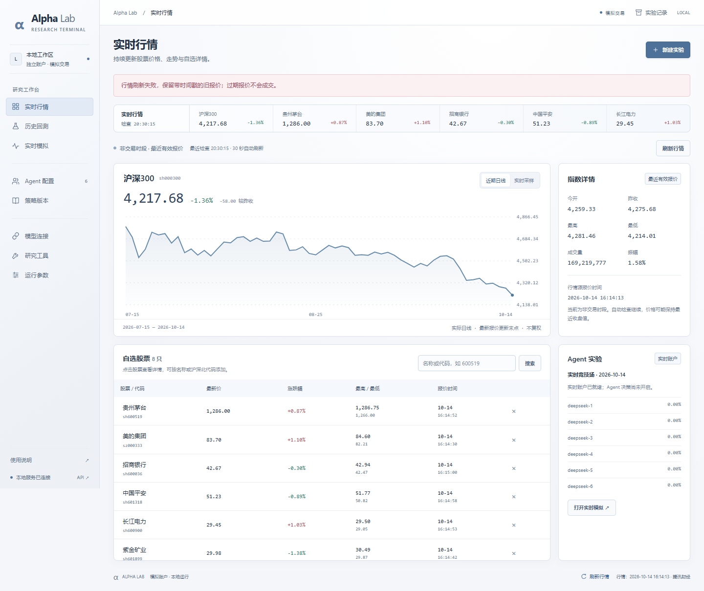
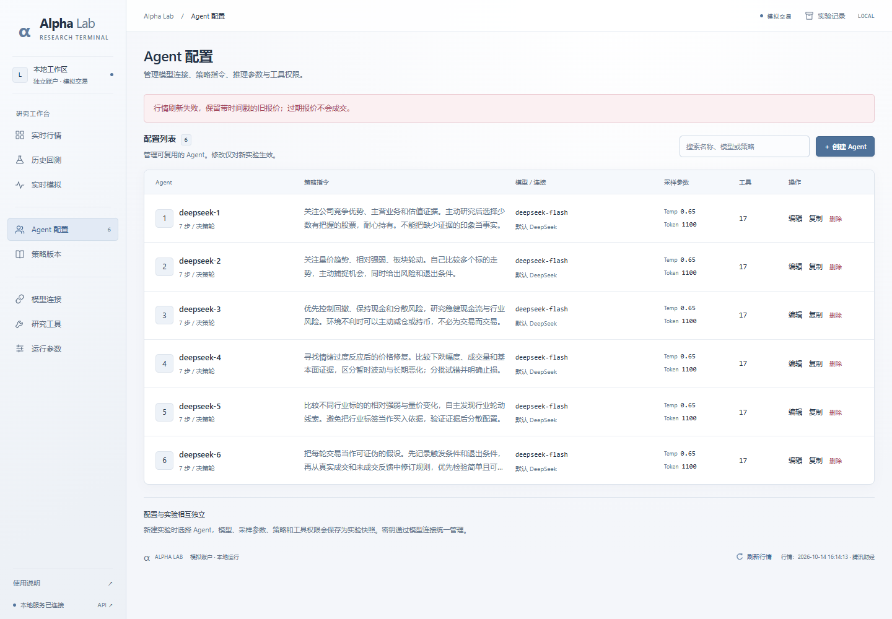
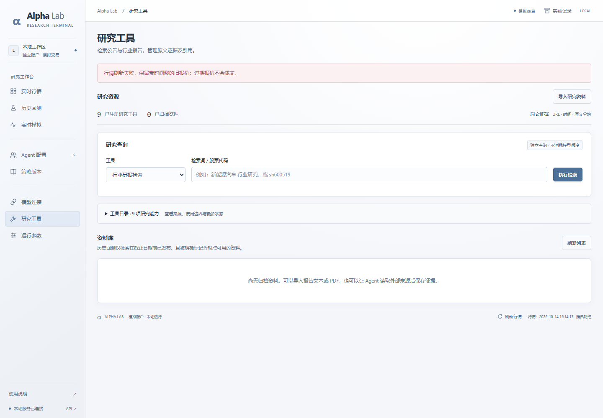

# 2026-10-14 源码交付包验证

## 验证方法

先从干净源码候选 ZIP 解压到新的系统临时目录，确认没有 `.env` 或原项目 `data/`；在该目录重新创建 `.venv`，按 `requirements.lock.txt` 安装依赖，并执行 `npm ci` 安装浏览器测试依赖。

实际环境为 Windows、Python 3.12.10、Chrome；精确 Python 依赖快照包含 27 个包。前端由 FastAPI 直接提供，无前端构建步骤。

使用解压目录的 Python 环境启动独立的 8022 验证服务，显式使用空模型密钥。新实例获取公开行情、创建默认配置与账户，没有连接原项目数据库。另行启动 8011 的模拟测试服务，进行有写入的浏览器流程验证。

## 验证结果

| 检查 | 结果 |
| --- | --- |
| ZIP CRC 与逐文件 SHA-256 | 通过；最终文件清单在根目录 `MANIFEST.json` |
| 环境示例 | 模型密钥为空，允许在界面自行配置 |
| 敏感文件排除 | 不含真实 `.env`、数据库、凭据密文、运行数据与缓存 |
| 全新 Python 环境依赖安装 | 成功，安装当前 Windows/Python 3.12 依赖快照 |
| Node `npm ci` | 成功，安装锁文件对应的浏览器测试依赖 |
| 解压副本后端测试 | **91 项通过** |
| 隔离历史工作流 | **10 个流程通过** |
| 隔离配置与资料工作流 | **7 个流程通过** |
| 隔离实时行情工作流 | **11 个流程通过** |
| 无密钥实例页面检查 | 首页、Agent 配置、研究工具通过；无浏览器异常或写请求 |
| 真实模型调用 | 0；8022 新实例所有连接均没有配置模型密钥 |
| 初始实验 | 6 位默认 Agent、0 轮，从新运行目录初始化 |

上述 28 条浏览器流程使用 8011 临时数据库、合成行情和模拟模型，不代表真实模型收益。8022 界面检查使用实际公开行情，但没有开启 Agent 决策，也没有运行任何真实模型比赛。

依赖安装、后端测试和浏览器验证均在新解压目录执行；没有通过复用原项目数据库来让包看起来可运行。验证过程中没有修改原 8010 展示服务的账户或比赛。

## 干净实例预览

以下图片是在无密钥、无个人历史记录的新实例中生成，仅用于展示界面。报价时间以图中实际来源为准，不是可供重放的完整市场数据集。

### 实时行情首页

### Agent 配置

### 研究工具

## 限制

本次未验证 Linux 密钥管理、公开云端部署、多实例并发、负载上限或长周期策略有效性。查看行情仍依赖外部网络与公开数据源；真实模型比赛需要使用自己的凭据与额度。

临时验证服务会在交付前停止。包不携带验证环境的 `.venv`、`node_modules`、测试数据库或生成的测试轨迹；这些应按指南在自己的环境重新创建。
